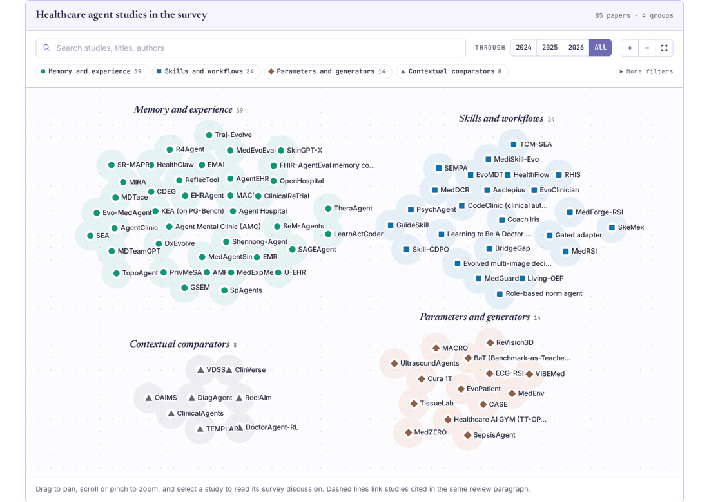
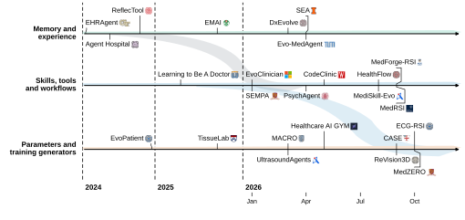

# A Survey on Recursive Self-Improvement in Healthcare AI Agents

**Dengzhe Hou · Zihao Wu · Yuwen Zeng · Lingyu Jiang · Fangzhou Lin · Kazunori D Yamada**

[Project homepage](https://dengzhe-hou.github.io/rsi-healthcare-agents/) · [Explore the map](https://dengzhe-hou.github.io/rsi-healthcare-agents/map/) · [All 85 papers](PAPERS.md) · [Evidence & templates](resources/) · [BibTeX](CITATION.bib)

A paper collection and evidence companion for healthcare agent self-improvement. Follow a study from its update mechanism to its controls, independent tests, original sources and discussion in the survey.

[](https://dengzhe-hou.github.io/rsi-healthcare-agents/map/)

The map contains **85 studies** from the fixed **4 November 2026** evidence snapshot. Lines connect papers cited in the same review paragraph. Select a paper for its mechanism overview, survey excerpts and source-linked evidence record. Search and filters also work in the paper index on small screens.

**Contents** · [Updates](#updates) · [What changes?](#what-changes) · [Start here](#start-here) · [Paper collection](#paper-collection) · [Data and templates](#data-and-templates) · [Rebuild](#rebuild-the-website) · [Contribute](#contribute) · [Citation](#citation)

## Updates

- **12 November 2026**. Added a connected paper map, manuscript-section browsing, a six-study reading guide and this categorized collection. The evidence release remains v0.3.2.
- **4 November 2026**. Unified search cutoff across arXiv, PubMed, Europe PMC and OpenAlex.

## What changes?

Persistent memory retains selected experience for later encounters. Reusable skills change the action sequences an agent can draw on. Training generators change the material used for later learning. RSI concerns revisions to the procedures that generate future improvements. The survey connects these mechanisms with healthcare evidence while recording mechanism change, performance benefit and clinical validation separately.

[](https://dengzhe-hou.github.io/rsi-healthcare-agents/#section-1)

## Start here

Six studies illustrated in the survey. The rows identify concrete update objects and evaluation designs, rather than rank methods.

| Study | Retained change and fixed components | Evaluation | Source and record |
| --- | --- | --- | --- |
| **MedExpMem** | Self-written pairwise differential-diagnosis notes change; VLM, retriever and prompts fixed. | Temporal split of 227 Eurorad 2025 cases; seven VLMs; RAG comparison and ablations. | [Paper](https://arxiv.org/html/2605.22872v1) · [Evidence](https://dengzhe-hou.github.io/rsi-healthcare-agents/map/#feng2026medexpmem) |
| **MACRO** | Memory, composite tools and policy change; discovery/training design fixed. | Public imaging benchmarks and static/component comparisons. | [Paper](https://arxiv.org/abs/2603.05860) · [Evidence](https://dengzhe-hou.github.io/rsi-healthcare-agents/map/#fan2026macro) |
| **TissueLab** | Tool classifiers and model preferences change; foundations/framework fixed. | Retrospective imaging/omics tasks and patient-level splits. | [Paper](https://arxiv.org/abs/2509.20279) · [Evidence](https://dengzhe-hou.github.io/rsi-healthcare-agents/map/#coevolving2025) |
| **DiagAgent / DiagGym** | Diagnostic policy parameters change; DiagGym and reward procedure fixed. | Physician-validated diagnostic benchmark cases. | [Paper](https://arxiv.org/abs/2510.24654v2) · [Evidence](https://dengzhe-hou.github.io/rsi-healthcare-agents/map/#qiu2025diaggym) |
| **ECG-RSI** | Waveform operators, prompts, skills and learner change; acceptance criteria fixed. | Patient-separated tests; frozen-generator-component controls; physician sample review. | [Paper](https://arxiv.org/html/2610.17718v1) · [Evidence](https://dengzhe-hou.github.io/rsi-healthcare-agents/map/#wang2026ecgrsi) |
| **ReVision3D** | Perception adapters, training recipe and inference program change; LLM designer, verifier and objective fixed. | Test CT patients, partly reused from earlier comparisons; frontier, recipe-control and designer comparisons. | [Paper](https://arxiv.org/abs/2609.32984v2) · [Evidence](https://dengzhe-hou.github.io/rsi-healthcare-agents/map/#lee2026revision3d) |

## Paper collection

The four groups below are the existing evidence-map categories. They are not a quality ranking. Publication venues come from the recorded bibliography, and preprint status reflects the fixed snapshot.

- [Memory and experience](PAPERS.md#memory) (39 studies)
- [Skills and workflows](PAPERS.md#skills) (24 studies)
- [Parameters and generators](PAPERS.md#generators) (14 studies)
- [Contextual comparators](PAPERS.md#comparators) (8 studies)

<details>
<summary><b>Memory and experience</b> · 39 studies</summary>

| Paper | Year / venue in bibliography | What changes | Evaluation |
| --- | --- | --- | --- |
| **[MDTace](https://link.springer.com/chapter/10.1007/978-981-92-3403-5_6)**<br>MDTace: Agentic Context Engineering for Multi-disciplinary Team Medical Consultation<br>[Evidence record](https://dengzhe-hou.github.io/rsi-healthcare-agents/map/#chen2027mdtace) | 2027<br>Intelligent Computing Theories and Application (ICIC 2026) | Structured consultation bullets change; backbone, lead/reflector prompts and memory procedure remain fixed. | Four clinical QA/VQA test sets; training-only bullets, Playbook and context-layer ablations. |
| **[AgentClinic](https://www.nature.com/articles/s41746-026-02674-7)**<br>AgentClinic: a multimodal benchmark for tool-using clinical AI agents<br>[Evidence record](https://dengzhe-hou.github.io/rsi-healthcare-agents/map/#schmidgall2026agentclinic) | 2026<br>npj Digital Medicine | Doctor-written diagnostic notebook is overwritten after each case; models and meta-prompt fixed. | AgentClinic-MedQA tool experiments across six backbones. |
| **[AgentEHR / RetroSum](https://arxiv.org/html/2601.13918v1)**<br>AgentEHR: Advancing Autonomous Clinical Decision-Making via Retrospective Summarization<br>[Evidence record](https://dengzhe-hou.github.io/rsi-healthcare-agents/map/#liao2026agentehr) | 2026<br>Preprint / report | Experience memory bank grows; LLM weights, prompts, tools and retriever fixed. | Held-out MIMIC-IV cohorts, two shifted subsets, evolved-versus-plain ablations, memory baselines. |
| **[AMR](https://arxiv.org/html/2608.19029v1)**<br>Adaptive Memory and Reflection Multi-Agent System for Medical Question Answering<br>[Evidence record](https://dengzhe-hou.github.io/rsi-healthcare-agents/map/#murugesan2026amr) | 2026<br>Preprint / report | Per-agent reflection memories change; GPT-4o, routing graph and RAG corpus fixed | MedQA test and MedMCQA subset; batches of 50, sizes unreported |
| **[CDEG](https://arxiv.org/html/2608.22899v3)**<br>CDEG: Learning Decision-Critical Evidence for Long-Horizon Diagnostic Agents<br>[Evidence record](https://dengzhe-hou.github.io/rsi-healthcare-agents/map/#dai2026cdeg) | 2026<br>Preprint / report | Evidence graph built from trajectories; doctor backbones, tools and environment fixed | 200 patient-disjoint MIMIC-IDx cases and 107 AgentClinic OOD cases |
| **[ClinicalReTrial](https://arxiv.org/html/2601.00290v3)**<br>ClinicalReTrial: Clinical Trial Redesign with Self-Evolving Agents<br>[Evidence record](https://dengzhe-hou.github.io/rsi-healthcare-agents/map/#xing2026clinicalretrial) | 2026<br>Preprint / report | Local and global redesign memory change; agents, predictor reward and validator fixed. | 60 held-out failed trials, paired ablations, independent HINT re-scoring, retrospective case studies. |
| **[DxEvolve](https://arxiv.org/html/2603.10677v1)**<br>Emulating Clinician Cognition via Self-Evolving Deep Clinical Research<br>[Evidence record](https://dengzhe-hou.github.io/rsi-healthcare-agents/map/#ren2026dxevolve) | 2026<br>arXiv preprint arXiv:2603.10677 | Diagnostic cognition profiles accumulate; construction prompts and retrieval fixed. | Non-overlapping MIMIC-CDM cases; 293 external hospital cases; physician profile review. |
| **[EMAI](https://www.sciencedirect.com/science/article/abs/pii/S016926072500495X)**<br>Experience-guided multi-agent interpretable framework for radiology report summarization<br>[Evidence record](https://dengzhe-hou.github.io/rsi-healthcare-agents/map/#li2026emai) | 2026<br>Computer Methods and Programs in Biomedicine | Report-derived experience rules evolve; backbone and rule induction/selection procedure remain fixed. | MIMIC-CXR and Open-I report summarisation with component ablations and clinician ratings. |
| **[EMR](https://arxiv.org/abs/2609.15161v1)**<br>EMR: Self-Evolving Medical Multi-Agent System via Experience Mining and Reuse<br>[Evidence record](https://dengzhe-hou.github.io/rsi-healthcare-agents/map/#shi2026emr) | 2026<br>arXiv preprint arXiv:2609.15161 | Principles, patterns and cases change; weights, retrieval and merge rule fixed. | Separated mining/test subsets; hierarchy and transfer analyses. |
| **[Evo-MedAgent](https://arxiv.org/html/2604.14475v1)**<br>Evo-MedAgent: Beyond One-Shot Diagnosis with Agents That Remember, Reflect, and Improve<br>[Evidence record](https://dengzhe-hou.github.io/rsi-healthcare-agents/map/#shen2026evomedagent) | 2026<br>arXiv preprint arXiv:2604.14475 | Error patterns, successful strategies and preferences change; models fixed. | Sequential ChestAgentBench evaluation and memory ablations. |
| **[FHIR-AgentEval memory configurations](https://www.researchsquare.com/article/rs-8746188/v1)**<br>FHIR-AgentEval: A Modular Sandbox for Benchmarking Clinical LLM Agents with an Evaluation of Memory-Augmented Configurations<br>[Evidence record](https://dengzhe-hou.github.io/rsi-healthcare-agents/map/#mokssit2026fhiragenteval) | 2026<br>npj Digital Medicine | Reflection memory changes; evaluation agent, reflector, validators and tools fixed. | Unseen variations and 22 held-out tasks; five configurations; three runs each. |
| **[GSEM](https://arxiv.org/html/2603.22096v1)**<br>GSEM: Graph-based Self-Evolving Memory for Experience Augmented Clinical Reasoning<br>[Evidence record](https://dengzhe-hou.github.io/rsi-healthcare-agents/map/#han2026gsem) | 2026<br>Proceedings of the 2026 Conference on Empirical Methods in Natural Language Processing | Graph-structured diagnostic memory and weights change; update rules fixed. | Clinical-reasoning/QA benchmarks and component analysis. |
| **[HealthClaw](https://arxiv.org/abs/2607.13940v1)**<br>A Self-Evolving Agent for Longitudinal Personal Health Management<br>[Evidence record](https://dengzhe-hou.github.io/rsi-healthcare-agents/map/#li2026healthclaw) | 2026<br>arXiv preprint arXiv:2607.13940 | Profile, procedures and episodes change; shared rules and induction design fixed. | Hidden-ledger synthetic-year probes and nine biomedical tasks. |
| **[LearnActCoder](https://arxiv.org/html/2609.19721v1)**<br>LearnActCoder: Role-Aware Error Memory for Adaptive Clinical Coding Agents<br>[Evidence record](https://dengzhe-hou.github.io/rsi-healthcare-agents/map/#ghaffari2026learnactcoder) | 2026<br>Preprint / report | Role-routed error memory changes; GPT-5, Coder-Judge workflow and lookup table fixed | Held-out matched MIMIC-III (150) and MIMIC-IV (250) notes; 1,000-note stability run |
| **[MDTeamGPT](https://aclanthology.org/2026.findings-acl.1427.pdf)**<br>MDTeamGPT: Mitigating Context Collapse and Enabling Self-Evolution in Medical Multi-Agent Reasoning<br>[Evidence record](https://dengzhe-hou.github.io/rsi-healthcare-agents/map/#chen2026mdteamgpt) | 2026<br>Preprint / report | Changes correct-case and error-reflection knowledge bases; backbone and consultation protocol stay fixed. | Official test sets, five runs, KB ablation and cross-dataset transfer. |
| **[MedEvoEval](https://arxiv.org/html/2606.28900v3)**<br>MedEvoEval: Evaluating Continual Evolution of Doctor Agents through Simulated Clinical Episodes<br>[Evidence record](https://dengzhe-hou.github.io/rsi-healthcare-agents/map/#zhang2026medevoeval) | 2026<br>Preprint / report | Rule-card memory bank grows; doctor, simulator, scorer and case order fixed | No-memory vs mature-memory on 200 held-out cases with Holm-corrected paired tests |
| **[MedExpMem](https://arxiv.org/html/2605.22872v1)**<br>MedExpMem: Adapting Experience Memory for Differential Diagnosis<br>[Evidence record](https://dengzhe-hou.github.io/rsi-healthcare-agents/map/#feng2026medexpmem) | 2026<br>Medical Image Computing and Computer Assisted Intervention – MICCAI 2026 | Self-written pairwise differential-diagnosis notes change; VLM, retriever and prompts fixed. | Temporal split of 227 Eurorad 2025 cases; seven VLMs; RAG comparison and ablations. |
| **[MIRA](https://arxiv.org/pdf/2608.10827v1)**<br>MIRA: Medical Image Reflection for Agentic Diagnosis<br>[Evidence record](https://dengzhe-hou.github.io/rsi-healthcare-agents/map/#wang2026mira) | 2026<br>Preprint / report | VLM weights and principle memory change; tools, judges, validation gate fixed | Nine medical VQA test splits; RL ablation isolating reflection memory contribution |
| **[OpenHospital](https://arxiv.org/html/2603.14771v3)**<br>OpenHospital: A Thing-in-itself Arena for Evolving and Benchmarking LLM-based Collective Intelligence<br>[Evidence record](https://dengzhe-hou.github.io/rsi-healthcare-agents/map/#liu2026openhospital) | 2026<br>Preprint / report | Reflection-derived physician experience accumulates; LLM weights and arena fixed. | Metric trajectories across training batches; no ablation, comparator, or repeated runs. |
| **[PrivMeSA](https://arxiv.org/abs/2609.38458v1)**<br>PrivMeSA: Privacy-Aware Self-Evolving Multi-Agent System for Medicine via Local-Remote LLM Collaboration<br>[Evidence record](https://dengzhe-hou.github.io/rsi-healthcare-agents/map/#wang2026privmesa) | 2026<br>Preprint / report | Lesson memory grows and LoRA policy is RL-trained; distiller, judge and specialists fixed. | Patient-disjoint MIMIC-IV-ED replay; baselines, ablations and paired memory-on/off run. |
| **[R4Agent](https://arxiv.org/html/2601.08192v2)**<br>Route, Retrieve, Reflect, Repair: Self-Improving Agentic Framework for Visual Detection and Linguistic Reasoning in Medical Imaging<br>[Evidence record](https://dengzhe-hou.github.io/rsi-healthcare-agents/map/#sayeedi2026r4) | 2026<br>Preprint / report | Exemplar memory grows from outputs; VLM backbones, router and agent prompts fixed. | IU X-ray reports, VinBigData boxes; model-judge and overlap metrics; pass@k ablation. |
| **[SAGEAgent](https://arxiv.org/html/2607.09521v1)**<br>SAGEAgent: A Self-Evolving Agent for Cost-Aware Modality Acquisition in Multimodal Survival Prediction<br>[Evidence record](https://dengzhe-hou.github.io/rsi-healthcare-agents/map/#qu2026sageagent) | 2026<br>Medical Image Computing and Computer Assisted Intervention – MICCAI 2026 | Episodic store and reflected rules change; frozen LLM, predictor and rewards fixed | Nested 5x5 cross-validation with memory ablations, fusion, RL and Reflexion baselines |
| **[SEA](https://arxiv.org/html/2604.07269v2)**<br>Joint Optimization of Reasoning and Dual-Memory for Self-Learning Diagnostic Agent<br>[Evidence record](https://dengzhe-hou.github.io/rsi-healthcare-agents/map/#li2026sea) | 2026<br>Preprint / report | Case and rule memory change in stream; RL-trained weights, candidate sets fixed | ER-Reason single-pass stream, untrained-writer memory controls; MedCaseReasoning test without carryover |
| **[SkinGPT-X](https://arxiv.org/html/2603.26122v1)**<br>SkinGPT-X: A Self-Evolving Collaborative Multi-Agent System for Transparent and Trustworthy Dermatological Diagnosis<br>[Evidence record](https://dengzhe-hou.github.io/rsi-healthcare-agents/map/#chen2026skingptx) | 2026<br>Preprint / report | Case memory and per-disease guidelines evolve; vision, diagnosis and review agents fixed. | Held-out splits of six datasets, memory ablation, blinded dermatologist review. |
| **[SpAgents](https://www.nature.com/articles/s41746-026-02372-4)**<br>Early diagnosis of axial spondyloarthritis in primary care using multi-agent systems<br>[Evidence record](https://dengzhe-hou.github.io/rsi-healthcare-agents/map/#ji2026spagents) | 2026<br>npj Digital Medicine | Labelled case memory grows; LLM agents, imaging tool and retrieval fixed. | Internal validation, 51-patient external test, memory ablation, seven-physician reader comparison. |
| **[SR-MAPR](https://ieeexplore.ieee.org/document/11452303)**<br>A Self-Reflective Multi-Agent Physician Recommendation Framework<br>[Evidence record](https://dengzhe-hou.github.io/rsi-healthcare-agents/map/#mao2026srmapr) | 2026<br>CNML 2026 | Physician-assessment heuristics change; backbone, reflection routine and retrieval design remain fixed. | 7362 physician profiles, stated80/20 split, backbone comparisons and rules/case/RAG ablations. |
| **[TheraAgent](https://arxiv.org/html/2603.13676v1)**<br>TheraAgent: Multi-Agent Framework with Self-Evolving Memory and Evidence-Calibrated Reasoning for PET Theranostics<br>[Evidence record](https://dengzhe-hou.github.io/rsi-healthcare-agents/map/#chen2026theraagent) | 2026<br>Preprint / report | Case-outcome memory and subgroup patterns grow; GPT-4o agents and trial knowledge fixed. | 35 real patients, 400 synthetic cases, agent baselines, memory-removal ablation. |
| **[TopoAgent](https://arxiv.org/html/2606.29763v1)**<br>TopoAgent: An Agentic Framework for Automated Topology Learning in Medical Imaging<br>[Evidence record](https://dengzhe-hou.github.io/rsi-healthcare-agents/map/#meng2026topoagent) | 2026<br>Preprint / report | Within-dataset failure-correction memory grows; GPT-4o, tools, distilled skill set fixed | Balanced accuracy on 26 benchmark datasets; memory ablations; three external datasets |
| **[Traj-Evolve](https://arxiv.org/html/2606.02812v1)**<br>Traj-Evolve: A Self-Evolving Multi-Agent System for Patient Trajectory Modeling in Lung Cancer Early Detection<br>[Evidence record](https://dengzhe-hou.github.io/rsi-healthcare-agents/map/#zeng2026trajevolve) | 2026<br>Preprint / report | Experience pool and LoRA agent weights change; architecture, embedder, reward rule fixed | Held-out overall and never-smoker test sets versus static Traj-CoA and ML baselines |
| **[U-EHR](https://dl.acm.org/doi/pdf/10.1145/3770855.3819038)**<br>U-EHR: A Self-Evolving EHR Agent with Step-Level Credit Assignment and UCB-Guided Memory Retrieval<br>[Evidence record](https://dengzhe-hou.github.io/rsi-healthcare-agents/map/#wu2026uehr) | 2026<br>Proceedings of the 32nd ACM SIGKDD Conference on Knowledge Discovery and Data Mining V.2 | Positive/negative memory and retrieval estimates change; backbone, scorers and UCB rules fixed. | MIMIC EHR tasks and private CN-EHR, four backbones; sequential adaptation and ablations. |
| **[KEA (on PG-Bench)](https://opus.lib.uts.edu.au/bitstream/10453/190868/2/main.pdf)**<br>Advancing Chinese Conversation-based Patient Guidance with a Benchmark and Knowledge-Evolvable Assistant<br>[Evidence record](https://dengzhe-hou.github.io/rsi-healthcare-agents/map/#lu2025kea) | 2025<br>IEEE Journal of Biomedical and Health Informatics | Experience and reflection banks grow; backbone LLM, retriever and knowledge base fixed. | Held-out 30% PG-Bench split; component ablation; frequency-shift test; three backbones. |
| **[MACD](https://arxiv.org/abs/2509.20067v5)**<br>MACD: Multi-Agent Clinical Diagnosis with Self-Learned Knowledge for LLM<br>[Evidence record](https://dengzhe-hou.github.io/rsi-healthcare-agents/map/#li2025macd) | 2025<br>Preprint / report | Self-learned diagnostic knowledge text changes; LLMs, summarizer and refiner fixed. | 3,076 held-out MIMIC cases; guideline knowledge, CoT, LoRA baselines; refiner ablation; reader study. |
| **[MedAgentSim](https://papers.miccai.org/miccai-2025/paper/2575_paper.pdf)**<br>MedAgentSim: Self-Evolving Multi-Agent Simulations for Realistic Clinical Interactions<br>[Evidence record](https://dengzhe-hou.github.io/rsi-healthcare-agents/map/#almansoori2025medagentsim) | 2025<br>Medical Image Computing and Computer Assisted Intervention – MICCAI 2025 | Successful cases and reflections retained; doctor model fixed. | Diagnostic simulations; component ablations. |
| **[ReflecTool](https://arxiv.org/html/2410.17657v3)**<br>ReflecTool: Towards Reflection-Aware Tool-Augmented Clinical Agents<br>[Evidence record](https://dengzhe-hou.github.io/rsi-healthcare-agents/map/#liao2025reflectool) | 2025<br>Proceedings of the 63rd Annual Meeting of the Association for Computational Linguistics (Volume 1: Long Papers) | Changes trajectory memory and tool-wise experience; Qwen2 backbone, toolbox and verifiers fixed. | Separate CAB test samples; ablations on 200 samples per dimension, single runs. |
| **[SeM-Agents](https://ieeexplore.ieee.org/document/10889517)**<br>A Self-Evolving Framework for Multi-Agent Medical Consultation Based on Large Language Models<br>[Evidence record](https://dengzhe-hou.github.io/rsi-healthcare-agents/map/#chen2025semagents) | 2025<br>ICASSP 2025 - IEEE International Conference on Acoustics, Speech and Signal Processing | Correct-case and error-reflection banks grow; backbone, consultation protocol and reviewer prompts stay fixed. | MedQA and PubMedQA test sets, memory variants and two-backbone evolution curves. |
| **[Agent Hospital / MedAgent-Zero](https://arxiv.org/abs/2405.02957v3)**<br>Agent Hospital: A Simulacrum of Hospital with Evolvable Medical Agents<br>[Evidence record](https://dengzhe-hou.github.io/rsi-healthcare-agents/map/#medhospital2024) | 2024<br>Preprint / report | Case database and principles change; model and reflection design fixed. | Separate simulated tests, MedQA and memory ablations. |
| **[Agent Mental Clinic (AMC)](https://arxiv.org/html/2409.15084v2)**<br>Depression Diagnosis Dialogue Simulation: Self-improving Psychiatrist with Tertiary Memory<br>[Evidence record](https://dengzhe-hou.github.io/rsi-healthcare-agents/map/#lan2024amc) | 2024<br>arXiv preprint arXiv:2409.15084 | Tertiary diagnostic memory changes; psychiatrist backbone fixed. | Dialogue-derived train/test cases; memory ablations. |
| **[EHRAgent](https://arxiv.org/html/2401.07128v3)**<br>EHRAgent: Code Empowers Large Language Models for Few-shot Complex Tabular Reasoning on Electronic Health Records<br>[Evidence record](https://dengzhe-hou.github.io/rsi-healthcare-agents/map/#shi2024ehragent) | 2024<br>Proceedings of the 2024 Conference on Empirical Methods in Natural Language Processing | Changes a memory of successful code solutions; GPT-4, tools and prompts stay fixed. | No separate held-out split; ablation without memory on MIMIC-III and eICU benchmarks. |
| **[Shennong-Agent](https://ieeexplore.ieee.org/document/10822302)**<br>Autonomous Pharmaceutical Care with Large Language Models<br>[Evidence record](https://dengzhe-hou.github.io/rsi-healthcare-agents/map/#dou2024shennongagent) | 2024<br>2024 IEEE International Conference on Bioinformatics and Biomedicine (BIBM) | Clinician corrections and prompts enter vector memory; Qwen-7B and module design remain fixed. | 461 retrospective outpatient records; pharmacist scoring and with/without human-intervention comparison. |

</details>

<details>
<summary><b>Skills and workflows</b> · 24 studies</summary>

| Paper | Year / venue in bibliography | What changes | Evaluation |
| --- | --- | --- | --- |
| **[Asclepius](https://arxiv.org/abs/2609.13543v1)**<br>Asclepius: An Adaptive Harness for Long-Horizon Clinical Agents<br>[Evidence record](https://dengzhe-hou.github.io/rsi-healthcare-agents/map/#yuan2026asclepius) | 2026<br>Findings of the Association for Computational Linguistics: EMNLP 2026 | Operating manual rewritten; backbone, skills library, subagent prompts and proposer fixed. | Four held-out simulated emergency-department batches; add-one ablations and manual-only contrast. |
| **[BridgeGap](https://aclanthology.org/2026.emnlp-main.1974.pdf)**<br>BridgeGap: Belief-Grounded Training for Medical Dialogue Agents<br>[Evidence record](https://dengzhe-hou.github.io/rsi-healthcare-agents/map/#li2026bridgegap) | 2026<br>Proceedings of the 2026 Conference on Empirical Methods in Natural Language Processing | Diagnostic dialogue policy learns; patient simulator, evidence verifier and reward routine stay fixed. | HealthBench, AgentClinic and static medical QA assess the resulting frozen policy. |
| **[CodeClinic (clinical autoformalization)](https://arxiv.org/html/2605.09675v1)**<br>CodeClinic: Evaluating Automation of Coding Skills for Clinical Reasoning Agents<br>[Evidence record](https://dengzhe-hou.github.io/rsi-healthcare-agents/map/#ossowski2026codeclinic) | 2026<br>Preprint / report | Verified function library grows; inference weights, verifier, threshold, guidelines fixed | 56,700 held-out queries and separate ICU surveillance task; zero-shot, GRPO controls |
| **[EvoClinician](https://arxiv.org/html/2601.22964v1)**<br>EvoClinician: A Self-Evolving Agent for Multi-Turn Medical Diagnosis via Test-Time Evolutionary Learning<br>[Evidence record](https://dengzhe-hou.github.io/rsi-healthcare-agents/map/#he2026evoclinician) | 2026<br>Preprint / report | Actor prompts and action-conditioned memory change; Evolver and Grader fixed. | Case-stream evaluations and memory/strategy ablations. |
| **[Evolved multi-image decision rules](https://arxiv.org/abs/2607.27564v1)**<br>Inference-Time Agentic Decision Rules Beat Longer Evolving Search for Multi-Image Medical Reasoning<br>[Evidence record](https://dengzhe-hou.github.io/rsi-healthcare-agents/map/#li2026decisionrules) | 2026<br>Preprint / report | Medical VQA prompt-program configurations evolve; proposer, VLM and selection pipeline remain fixed. | MedFrameQA internal video-grouped split; five main-method repeats on 855 final-test examples. |
| **[EvoMDT](https://www.nature.com/articles/s41746-025-02304-8)**<br>EvoMDT: a self-evolving multi-agent system for structured clinical decision-making in multi-cancer<br>[Evidence record](https://dengzhe-hou.github.io/rsi-healthcare-agents/map/#liu2026evomdt) | 2026<br>npj Digital Medicine | Prompts and agent configuration adapt; framework/evaluator prescribed. | QA datasets, retrospective records and blinded physician scoring. |
| **[Gated adapter / OpenClaw agent](https://ijocsit.org/pdf/2026/10.62051-ijcsit.v8n4.01.pdf)**<br>Self-Evolving Diagnostic Framework based Gated Residual Adapters and OpenClaw-Based Medical Agents<br>[Evidence record](https://dengzhe-hou.github.io/rsi-healthcare-agents/map/#feng2026gatedopenclaw) | 2026<br>International Journal of Computer Science and Information Technology | Persistent guidance and final adapter gate change; encoders and update routine remain fixed. | Private fundus images; conflict counts assessed across repeated adaptation rounds. |
| **[GuideSkill](https://arxiv.org/html/2607.26160v1)**<br>GuideSkill: Evolving Executable LLM Agent Skills for Guideline-Grounded Clinical Reasoning<br>[Evidence record](https://dengzhe-hou.github.io/rsi-healthcare-agents/map/#cao2026guideskill) | 2026<br>Preprint / report | Executable diagnostic scoring skills evolve; backbone, compiler and skill generator remain fixed. | Four diagnostic benchmarks; evolved skills assessed across four fixed task backbones. |
| **[HealthFlow](https://www.nature.com/articles/s41746-026-03097-0)**<br>HealthFlow: automating electronic health record analysis via a strategically self-evolving multi-agent framework<br>[Evidence record](https://dengzhe-hou.github.io/rsi-healthcare-agents/map/#zhu2026healthflow) | 2026<br>npj Digital Medicine | Plans, workflow code and experience change; writeback/retrieval rules fixed. | External model judge and blinded expert report review; online memory runs. |
| **[Living-OEP](https://pmc.ncbi.nlm.nih.gov/articles/PMC13563553/)**<br>Development and validation of a human-supervised AI-augmented living oncology evidence platform: a breast cancer pilot study<br>[Evidence record](https://dengzhe-hou.github.io/rsi-healthcare-agents/map/#rugo2026livingoep) | 2026<br>ESMO Real World Data and Digital Oncology | Annotation instructions and examples change; clinical LLM backbones and human update procedure fixed. | 1997 independent breast-cancer publications and eight clinical evidence-retrieval scenarios; human quality review. |
| **[MedDCR](https://arxiv.org/html/2511.13361v1)**<br>MedDCR: Learning to Design Agentic Workflows for Medical Coding<br>[Evidence record](https://dengzhe-hou.github.io/rsi-healthcare-agents/map/#zheng2026meddcr) | 2026<br>Preprint / report | Coding workflows and design archive change; Designer, Reflector and selection rule fixed. | MDACE and ACI-BENCH micro-F1; archive and feedback ablations; no separate test split described. |
| **[MedForge-RSI](https://arxiv.org/abs/2609.36549v1)**<br>MedForge-RSI: Medical Deepfake Detection via Recursive Self-Improvement<br>[Evidence record](https://dengzhe-hou.github.io/rsi-healthcare-agents/map/#chen2026medforge) | 2026<br>arXiv preprint arXiv:2609.36549 | Experience, tools and optional directives change; detector and acceptance design fixed. | Disjoint final 4,000-image test; mechanism/seed analyses. |
| **[MedGuard](https://www.nature.com/articles/s41746-026-03116-0_reference.pdf)**<br>MedGuard: an LLM-based gatekeeper for detecting clinical risks in Chinese telemedicine consultations<br>[Evidence record](https://dengzhe-hou.github.io/rsi-healthcare-agents/map/#shi2026medguard) | 2026<br>npj Digital Medicine | Agent policy weights change; prompts, retrieval knowledge base and training generator stay fixed. | Separate consultation benchmarks, retrospective records and expert ratings assess risk-alerting outputs. |
| **[MediSkill-Evo](https://arxiv.org/html/2608.23397v2)**<br>MediSkill-Evo: Process-Constrained Self-Evolution for Evidence-Grounded Clinical Interaction<br>[Evidence record](https://dengzhe-hou.github.io/rsi-healthcare-agents/map/#wu2026mediskillevo) | 2026<br>Preprint / report | Four typed knowledge banks change; backbone, harness, simulator and evaluator fixed | 300 held-out MIMIC-IV encounters, 180 stress conditions, 100 NEJM cases |
| **[MedRSI](https://arxiv.org/html/2609.24838v1)**<br>MedRSI: Recursive Self-Improvement for Medical Agents via Clinically Aligned Self-Evolution<br>[Evidence record](https://dengzhe-hou.github.io/rsi-healthcare-agents/map/#wu2026medrsi) | 2026<br>Preprint / report | Tools and trainable tool models change; reasoner, execution and judge fixed. | Public imaging tests and frozen-checkpoint retrospective cohorts. |
| **[PsychAgent](https://arxiv.org/html/2604.00931v3)**<br>PsychAgent: An Experience-Driven Lifelong Learning Agent for Self-Evolving Psychological Counselor<br>[Evidence record](https://dengzhe-hou.github.io/rsi-healthcare-agents/map/#yang2026psychagent) | 2026<br>Preprint / report | Skills and shared model parameters change; session-selection rule fixed. | Separate client profiles; human ratings of simulated dialogues. |
| **[RHIS](https://papers.ssrn.com/sol3/papers.cfm?abstract_id=7482519)**<br>From API Acknowledgment to Clinical State: Runtime Governance, Controlled Self-Evolution, and Cost in MedAgentBench<br>[Evidence record](https://dengzhe-hou.github.io/rsi-healthcare-agents/map/#chen2026rhis) | 2026<br>Preprint / report | Action-governance rules change; Kimi backbone, benchmark source and change-admission protocol remain fixed. | 300 virtual-EHR tasks; named same-stage retests separated from cross-version first-pass totals. |
| **[Role-based norm agent](https://aclanthology.org/2026.findings-acl.1133.pdf)**<br>A Self-Evolving LLM Agent Framework for Role-Based Norm Compliance in Healthcare<br>[Evidence record](https://dengzhe-hou.github.io/rsi-healthcare-agents/map/#ruan2026normcompliance) | 2026<br>Findings of the Association for Computational Linguistics: ACL 2026 | Norm memory and role prompts evolve; Qwen-plus weights and feedback routines remain fixed. | Three simulated healthcare communication tasks compare full framework and component ablations. |
| **[SEMPA](https://aclanthology.org/2026.findings-emnlp.994.pdf)**<br>Self-Evolving Dual-Role Deliberation for Medication Recommendation from Clinical Records<br>[Evidence record](https://dengzhe-hou.github.io/rsi-healthcare-agents/map/#jiang2026sempa) | 2026<br>Findings of the Association for Computational Linguistics: EMNLP 2026 | Prescribing and Critic policies evolve; backbone, rewrite routine and safety rules stay fixed. | One hundred retrospective MIMIC-IV encounters, six runs and component ablations. |
| **[SkeMex](https://arxiv.org/html/2606.09365v4)**<br>Experience Makes Skillful: Enabling Generalizable Medical Agent Reasoning via Self-Evolving Skill Memory<br>[Evidence record](https://dengzhe-hou.github.io/rsi-healthcare-agents/map/#sun2026skemex) | 2026<br>Preprint / report | Skill repository and utility state change; online update operators fixed. | Held-out in-domain cases, unseen benchmark families and cross-model skill transfer. |
| **[Skill-CDPO](https://aclanthology.org/2026.findings-emnlp.1985.pdf)**<br>Skill-CDPO: Evolving Agent Tool-Use via Critical Step Preference Optimization<br>[Evidence record](https://dengzhe-hou.github.io/rsi-healthcare-agents/map/#li2026skillcdpo) | 2026<br>Findings of the Association for Computational Linguistics: EMNLP 2026 | Experience-derived tool skills and agent weights change; expert and selection procedure stay fixed. | Three medical retrieval and QA benchmarks compare skills, SFT and DPO variants. |
| **[TCM-SEA / TCM-MisDx](https://arxiv.org/abs/2610.40663v1)**<br>Learning from Expert-Corrected Misdiagnoses: A Self-Evolving Consultation Agent for Traditional Chinese Medicine after Failed Treatment<br>[Evidence record](https://dengzhe-hou.github.io/rsi-healthcare-agents/map/#wang2026tcmsea) | 2026<br>Preprint / report | Clinical skill document edited; LLM, edit loop, gate and simulator fixed. | Gate on held-in and validation splits; sealed test split; outcome-only ablation. |
| **[Coach Iris / FAST](https://www.frontiersin.org/journals/digital-health/articles/10.3389/fdgth.2025.1460236/full)**<br>Think FAST: a novel framework to evaluate fidelity, accuracy, safety, and tone in conversational AI health coach dialogues<br>[Evidence record](https://dengzhe-hou.github.io/rsi-healthcare-agents/map/#neary2025fast) | 2025<br>Frontiers in Digital Health | Shared prompts, retrieval data and responses change; backbone and optimization details unreported. | Framework face validity on recorded dialogues; five reviewers initially assess twelve dialogues. |
| **[Learning to Be A Doctor (medical agent workflow search)](https://arxiv.org/html/2504.11301v2)**<br>Learning to Be A Doctor: Searching for Effective Medical Agent Architectures<br>[Evidence record](https://dengzhe-hou.github.io/rsi-healthcare-agents/map/#zhuang2025doctor) | 2025<br>Proceedings of the 33rd ACM International Conference on Multimedia | Changes workflow graph and node prompts; backbone LLM, tools and evolution procedure fixed. | Held-out test images; static baselines and operation ablations; single seed, three backbones. |

</details>

<details>
<summary><b>Parameters and generators</b> · 14 studies</summary>

| Paper | Year / venue in bibliography | What changes | Evaluation |
| --- | --- | --- | --- |
| **[BaT (Benchmark-as-Teacher)](https://arxiv.org/html/2608.16211v1)**<br>BaT: Towards Self-Evolving Medical Research Agent with Stage Rubrics<br>[Evidence record](https://dengzhe-hou.github.io/rsi-healthcare-agents/map/#liu2026bat) | 2026<br>Preprint / report | Agent policy and stage curriculum change; execution environment, verifier, controller fixed | AutoMedBench-Lite also steers training; ABRA, MedXpertQA, external benchmarks unselected |
| **[CASE](https://arxiv.org/html/2609.39566v3)**<br>From Given to Gathered Evidence: Agentic Learning for Longitudinal Medical Reasoning<br>[Evidence record](https://dengzhe-hou.github.io/rsi-healthcare-agents/map/#shao2026case) | 2026<br>Preprint / report | 8B VLM policy weights change; tools, judge, evidence replay and prompts fixed | 4,850 questions from 455 held-out UK Biobank participants, three roles |
| **[Cura 1T](https://arxiv.org/html/2607.15314v3)**<br>Cura 1T: Healthcare Foundation Model via Recursive Self-Improvement<br>[Evidence record](https://dengzhe-hou.github.io/rsi-healthcare-agents/map/#chen2026cura) | 2026<br>Preprint / report | Training mixture and 1T weights change; harness skills, benchmarks, human review fixed | Same healthcare benchmarks used for selection; out-of-domain checks not used for selection |
| **[ECG-RSI](https://arxiv.org/html/2610.17718v1)**<br>ECG-RSI: Recursive Self-Improvement through Targeted Electrocardiogram Waveform Evolution<br>[Evidence record](https://dengzhe-hou.github.io/rsi-healthcare-agents/map/#wang2026ecgrsi) | 2026<br>Preprint / report | Waveform operators, prompts, skills and learner change; acceptance criteria fixed. | Patient-separated tests; frozen-generator-component controls; physician sample review. |
| **[Healthcare AI GYM (TT-OPD)](https://arxiv.org/html/2605.02943v1)**<br>Healthcare AI GYM for Medical Agents<br>[Evidence record](https://dengzhe-hou.github.io/rsi-healthcare-agents/map/#jeong2026healthcaregym) | 2026<br>Preprint / report | Qwen3.5-9B weights change by GRPO/TT-OPD; gym tasks, tools, reward fixed | 18 benchmarks with same tools; Base+AR and GRPO controls; validation 307 tasks |
| **[MACRO](https://arxiv.org/abs/2603.05860)**<br>Evolving Medical Imaging Agents via Experience-driven Self-skill Discovery<br>[Evidence record](https://dengzhe-hou.github.io/rsi-healthcare-agents/map/#fan2026macro) | 2026<br>Preprint / report | Memory, composite tools and policy change; discovery/training design fixed. | Public imaging benchmarks and static/component comparisons. |
| **[MedEnv / Diagnosis-R1](https://papers.miccai.org/miccai-2026/paper/5084_paper.pdf)**<br>MedEnv: Scaling Multimodal Virtual Medical Environments for Long-Horizon Diagnosis<br>[Evidence record](https://dengzhe-hou.github.io/rsi-healthcare-agents/map/#fan2026medenv) | 2026<br>Medical Image Computing and Computer Assisted Intervention - MICCAI 2026 | Doctor policy changes and supplies a specified reward likelihood; GRPO and simulators fixed. | Two thousand held-out cases per author response; matched reward/training ablations. |
| **[MedZERO](https://arxiv.org/html/2610.08327v1)**<br>MedZERO: Self-Evolving Agents for Open-Ended Medical Reasoning Through Controlled Knowledge Accumulation<br>[Evidence record](https://dengzhe-hou.github.io/rsi-healthcare-agents/map/#dang2026medzero) | 2026<br>Preprint / report | Examiner and Reasoner parameters plus knowledge graph change; reward/curation rules fixed. | Medical benchmarks and curriculum-source/component analyses. |
| **[ReVision3D](https://arxiv.org/abs/2609.32984v2)**<br>ReVision3D: Attribution-Guided Recursive Self-Improvement for 3D Medical Perception<br>[Evidence record](https://dengzhe-hou.github.io/rsi-healthcare-agents/map/#lee2026revision3d) | 2026<br>Preprint / report | Perception adapters, training recipe and inference program change; LLM designer, verifier and objective fixed. | Test CT patients, partly reused from earlier comparisons; frontier, recipe-control and designer comparisons. |
| **[SepsisAgent](https://arxiv.org/html/2605.14723v1)**<br>Agentifying Patient Dynamics within LLMs through Interacting with Clinical World Model<br>[Evidence record](https://dengzhe-hou.github.io/rsi-healthcare-agents/map/#wu2026sepsisagent) | 2026<br>Preprint / report | Qwen3-4B weights change across SFT, BC, GRPO; world model and rewards fixed | 725 held-out MIMIC-IV episodes by OPE; untrained world-model agents as controls |
| **[UltrasoundAgents](https://arxiv.org/html/2603.10852v1)**<br>UltrasoundAgents: Hierarchical Multi-Agent Evidence-Chain Reasoning for Breast Ultrasound Diagnosis<br>[Evidence record](https://dengzhe-hou.github.io/rsi-healthcare-agents/map/#zhu2026ultrasoundagents) | 2026<br>Preprint / report | Sub-agent and main-agent VLM weights change; tools, taxonomy, rewards and recipe fixed. | Three in-domain test splits, external BrEaST OOD set, stage ablations, oracle upper bounds. |
| **[VIBEMed](https://arxiv.org/abs/2606.15504v2)**<br>Toward Vibe Medicine: A Self-Evolving Multi-Agent Framework for Clinical Decision Support<br>[Evidence record](https://dengzhe-hou.github.io/rsi-healthcare-agents/map/#zhang2026vibemed) | 2026<br>Meta-Radiology | Memory/model/code changes described; coordinated update workflow prescribed. | Base-versus-tuned MedBench comparison and oncology demonstration. |
| **[EvoPatient](https://aclanthology.org/2025.acl-long.846.pdf)**<br>LLMs Can Simulate Standardized Patients via Agent Coevolution<br>[Evidence record](https://dengzhe-hou.github.io/rsi-healthcare-agents/map/#du2025evopatient) | 2025<br>Proceedings of the 63rd Annual Meeting of the Association for Computational Linguistics (Volume 1: Long Papers) | Doctor trajectory memory changes patient-training interactions; validation rules fixed. | Doctor-question and patient-ability analyses; disease transfer. |
| **[TissueLab](https://arxiv.org/abs/2509.20279)**<br>A Co-Evolving Agentic AI System for Medical Imaging Analysis<br>[Evidence record](https://dengzhe-hou.github.io/rsi-healthcare-agents/map/#coevolving2025) | 2025<br>Preprint / report | Tool classifiers and model preferences change; foundations/framework fixed. | Retrospective imaging/omics tasks and patient-level splits. |

</details>

<details>
<summary><b>Contextual comparators</b> · 8 studies</summary>

| Paper | Year / venue in bibliography | What changes | Evaluation |
| --- | --- | --- | --- |
| **[ClinicalAgents](https://arxiv.org/abs/2603.26182v2)**<br>ClinicalAgents: Multi-Agent Orchestration for Clinical Decision Making with Dual-Memory<br>[Evidence record](https://dengzhe-hou.github.io/rsi-healthcare-agents/map/#clinicalagents2026) | 2026<br>Proceedings of the 32nd ACM SIGKDD Conference on Knowledge Discovery and Data Mining V.2 | Within-case working state changes; experience store remains static. | Experience/test separation and clinician-checked model judge. |
| **[ClinVerse](https://arxiv.org/html/2610.34878v1)**<br>ClinVerse: A Realistic Multi-Agent Diagnostic Environment for Training and Evaluating Medical Agents<br>[Evidence record](https://dengzhe-hou.github.io/rsi-healthcare-agents/map/#chen2026clinverse) | 2026<br>Preprint / report | Memories, skills, playbooks, tool registry change; Qwen3-32B, simulator, rule-based judge fixed | 100 held-out EHR cases, five runs; zero-shot transfer to AIHospital |
| **[DoctorAgent-RL](https://arxiv.org/html/2505.19630v3)**<br>DoctorAgent-RL: A Multi-Agent Collaborative Reinforcement Learning System for Multi-Turn Clinical Dialogue<br>[Evidence record](https://dengzhe-hou.github.io/rsi-healthcare-agents/map/#feng2025doctoragentrl) | 2026<br>ICASSP 2026 - 2026 IEEE International Conference on Acoustics, Speech and Signal Processing (ICASSP) | Doctor policy updates; interaction and reward design fixed. | Dialogue-derived simulated consultation evaluation. |
| **[OAIMS](https://arxiv.org/abs/2503.06717v4)**<br>You Point, I Learn: Online Adaptation of Interactive Segmentation Models for Handling Distribution Shifts in Medical Imaging<br>[Evidence record](https://dengzhe-hou.github.io/rsi-healthcare-agents/map/#xu2026oaims) | 2026<br>International Conference on Learning Representations (ICLR) | Segmentation weights adapt; online update procedure fixed. | Retrospective streams with imaging modality/pathology shifts. |
| **[ReclAIm](https://arxiv.org/pdf/2510.17004v2)**<br>ReclAIm: A Multiagent Framework for Monitoring and Correcting Performance Decline in Medical Imaging AI<br>[Evidence record](https://dengzhe-hou.github.io/rsi-healthcare-agents/map/#tzanis2026reclaim) | 2026<br>Radiology: Artificial Intelligence | Image-classifier weights adapt; agent workflow and alarm rule fixed. | Separate fine-tuning cohort; same monitoring cohort used for reassessment. |
| **[TEMPLAR](https://arxiv.org/abs/2610.05247v1)**<br>TEMPLAR: Agentic Induction and Evolution of Standardized Radiology Reporting Templates from Large-Scale Clinical Corpora<br>[Evidence record](https://dengzhe-hou.github.io/rsi-healthcare-agents/map/#hu2026templar) | 2026<br>Preprint / report | Radiology reporting template and knowledge graphs built once; LLMs, prompts and rules fixed. | Held-out PET/CT and CT reports; ablations, cross-dataset transfer and expert ratings. |
| **[VDSS](https://arxiv.org/html/2605.23320v1)**<br>Human-in-the-Loop Multi-Agent Ventilator Decision Support with Contextual Bandit Preference Learning<br>[Evidence record](https://dengzhe-hou.github.io/rsi-healthcare-agents/map/#li2026vdss) | 2026<br>Medical Image Computing and Computer Assisted Intervention – MICCAI 2026 | Clinician preference bandit state updates; LLM agents, safety checks, backbones fixed | Multi-center retrospective replay and expert ratings of 100 cycles; NoPref ablation |
| **[DiagAgent / DiagGym](https://arxiv.org/abs/2510.24654v2)**<br>Evolving Interactive Diagnostic Agents in a Virtual Clinical Environment<br>[Evidence record](https://dengzhe-hou.github.io/rsi-healthcare-agents/map/#qiu2025diaggym) | 2025<br>Preprint / report | Diagnostic policy parameters change; DiagGym and reward procedure fixed. | Physician-validated diagnostic benchmark cases. |

</details>

## Data and templates

| Resource | Reuse it for |
| --- | --- |
| [85-study design matrix](resources/snapshots/2026-11-04/study_design_matrix.html) | Compare mutable objects, fixed components, controls and independent tests |
| [Evidence CSV](resources/snapshots/2026-11-04/evidence_map.csv) · [JSON](resources/snapshots/2026-11-04/evidence_map.json) | Reuse extraction records and original source locators |
| [Evaluation guide](resources/EVALUATION_DESIGN_TEMPLATE.pdf) · [templates](resources/templates/README.md) · [worked examples](resources/examples/worked_designs.json) | Plan and record an experiment |
| [Codebook](resources/CODEBOOK.md) · [coding guide](resources/EVIDENCE_CODING_GUIDE.md) | Interpret a field or apply the existing coding rules |
| [Search method](resources/snapshots/2026-11-04/SEARCH_METHOD.md) · [screening ledger](resources/snapshots/2026-11-04/screening_decisions.html) | Follow the search and 10,720 deduplicated screening decisions |
| [Source bibliography](resources/references_mapped.bib) · [complete S3 table](resources/snapshots/2026-11-04/mechanism_summaries.pdf) | Read all 85 source citations and extraction summaries |

The fixed release is [evidence-2026-11-04-v0.3.2](https://github.com/dengzhe-hou/rsi-healthcare-agents/tree/evidence-2026-11-04-v0.3.2). Website navigation is maintained separately from the evidence release.

## Rebuild the website

The site is static HTML, CSS and JavaScript. The data builder uses Python’s standard library, joins the released records by bibliography key, and uses the saved section/co-discussion index. It regenerates the network data and paper collection without changing the evidence snapshot.

```bash
python scripts/build_map.py
python -m http.server 8000
```

Open `http://localhost:8000/`. See [map documentation](map/README.md) for the layout, survey-link provenance and optional LaTeX context refresh.

## Contribute

Corrections and paper suggestions are welcome through [GitHub issues](https://github.com/dengzhe-hou/rsi-healthcare-agents/issues). Please include the bibliography key, exact field, primary-source passage and proposed correction. Follow [CONTRIBUTING.md](CONTRIBUTING.md). Suggestions enter a later evidence release; the fixed snapshot is preserved.

## Citation

Use [CITATION.bib](CITATION.bib) or [CITATION.cff](CITATION.cff). Cite the fixed evidence version when reusing its records, and credit the primary studies for their findings.

## Manuscript and review status

The revised manuscript is under author revision. The [earlier Preprints.org version](https://www.preprints.org/manuscript/202605.1547) has different contents and an earlier title. The full revised manuscript PDF is not published in this repository.

Screening and extraction were LLM-assisted. Author verification is incomplete, and the fixed sample-check plan was withdrawn without being performed. See [review status](resources/REVIEW_STATUS.md), [rights](resources/RIGHTS.md) and [versions](resources/VERSIONS.md). No additional open-content license has been selected. The bundled Newsreader fonts retain their separate [SIL Open Font License](assets/fonts/OFL.txt).
