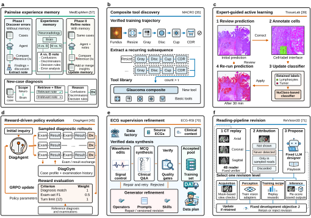

# A Survey on Recursive Self-Improvement in Healthcare AI Agents

By Dengzhe Hou, Zihao Wu, Yuwen Zeng, Lingyu Jiang, Fangzhou Lin and Kazunori D Yamada.

[Project homepage](https://dengzhe-hou.github.io/rsi-healthcare-agents/) · [Explore the map](https://dengzhe-hou.github.io/rsi-healthcare-agents/map/) · [Paper index](PAPERS.md) · [Evidence resources](resources/) · [BibTeX](CITATION.bib)

A source-linked review of persistent memory, reusable skills, adaptive training and evaluation in healthcare AI agents. The fixed 4 November 2026 evidence snapshot contains **85 mapped studies**, including **25 imaging and radiology-report studies**, with **10,720 deduplicated screening records**.



[Open the vector figure](https://dengzhe-hou.github.io/rsi-healthcare-agents/assets/mechanism_examples.svg) · [Figure sources](assets/FIGURE_CREDITS.md)

## Start with a question

| What you need | Where to go |
| --- | --- |
| Find a study and inspect its update mechanism | [Interactive map](https://dengzhe-hou.github.io/rsi-healthcare-agents/map/) |
| Compare controls, fixed components and independent tests | [85-study design matrix](resources/snapshots/2026-11-04/study_design_matrix.html) |
| Reuse the extraction records | [CSV](resources/snapshots/2026-11-04/evidence_map.csv), [JSON](resources/snapshots/2026-11-04/evidence_map.json), [85 source citations](resources/references_mapped.bib) |
| Design an experiment | [Evaluation guide](resources/EVALUATION_DESIGN_TEMPLATE.pdf), [templates](resources/templates/README.md), [worked examples](resources/examples/worked_designs.json) |
| Follow the search and eligibility decisions | [Search method](resources/snapshots/2026-11-04/SEARCH_METHOD.md), [screening ledger](resources/snapshots/2026-11-04/screening_decisions.html) |
| Check a field definition | [Codebook](resources/CODEBOOK.md), [coding guide](resources/EVIDENCE_CODING_GUIDE.md) |

The map uses existing mechanism groups and supports search, evidence-level and evaluation-setting filters, source-linked study details, record downloads and BibTeX copying. Positions group recorded categories. They do not encode semantic similarity or evidence strength.

## Reproduce the website data

The site uses plain HTML, CSS and JavaScript. No build tools or paid services are required.

```bash
python scripts/build_map.py
python -m http.server 8000
```

Open `http://localhost:8000/`. The builder joins the fixed evidence map and study-design matrix by stable bibliography key and regenerates `map/data.json` and `PAPERS.md`.

## Cite and contribute

Use [CITATION.cff](CITATION.cff) or [BibTeX](CITATION.bib). Identify the fixed [v0.3.2 evidence release](https://github.com/dengzhe-hou/rsi-healthcare-agents/tree/evidence-2026-11-04-v0.3.2) when reusing its extraction records. Credit the primary studies for their findings.

Please follow [CONTRIBUTING.md](CONTRIBUTING.md) to report a correction or suggest a study. The fixed snapshot is preserved between evidence releases.

## Manuscript and review status

The revised manuscript is under author revision. The [earlier Preprints.org version](https://www.preprints.org/manuscript/202605.1547) has different contents and an earlier title. ArXiv upload and submission remain paused.

Screening and extraction were LLM-assisted. Author verification is incomplete, and the fixed sample-check plan was withdrawn without being performed. Read [review status](resources/REVIEW_STATUS.md), [rights](resources/RIGHTS.md) and [versions](resources/VERSIONS.md). No additional open-content license has been selected.
